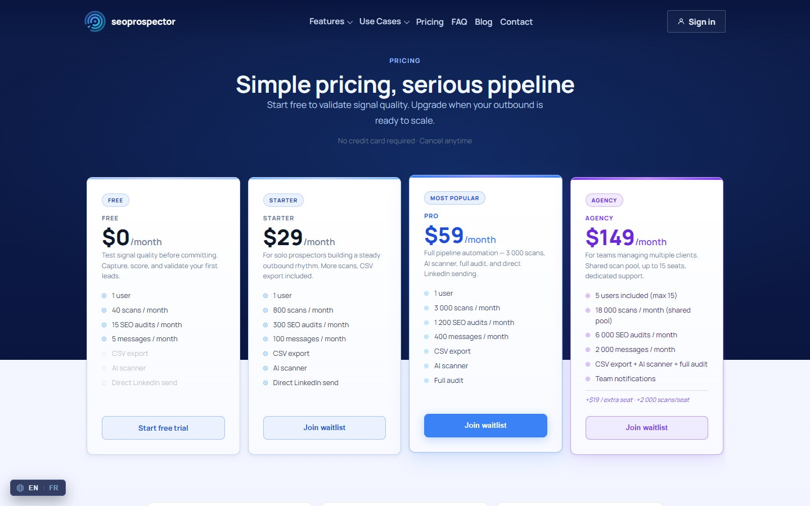

# SEO Prospector Dashboard — web app and marketing site (Next.js)

The **web front-end of the LinkedIn SEO Prospector SaaS**: the customer dashboard where captured leads, SEO audits and generated messages are managed, plus the public marketing site. It talks to the Fastify API from [`linkedin-seo-prospector`](https://github.com/DexterYKC/linkedin-seo-prospector), which in turn runs the scoring and AI workflows in n8n.

> **Status: functional, unpolished.** Everything below works against the API, but the UI never got a proper design pass and the product is no longer live: the extension was published on the Chrome Web Store, then taken down by Google, and its backend ran on a free hosting tier that I never upgraded. Shared as a portfolio piece. Production domains and emails were replaced with `example.com` placeholders.

## Screenshot

The customer dashboard, moderator console and team screens need a live `api-saas` instance behind them, so they cannot be shown here; the extension side panel they mirror is shown in the [`linkedin-seo-prospector`](https://github.com/DexterYKC/linkedin-seo-prospector#screenshots) README. What this repo can show on its own is the public **pricing page**, captured from the running app: four plans (Free, Starter, Pro, Agency) with the scan, SEO-audit and message quotas that the API enforces.



## What's in it

**Customer dashboard (`src/app/(app)`)**
- Overview with quota and usage indicators (monthly scans, plan state)
- **Leads** list with SEO score, decision-maker signal and priority, synced from the browser extension
- **SEO audit** view per lead, with single-audit **CSV export**
- **Messages**: generated outreach drafts, history and logs
- **Agency / team**: seats, member invitations (signed invite links), per-member dashboards, team chat
- **Support**: ticket list and conversation view
- Account and settings (profile, password, plan), notifications

**Back-office**
- Admin page: users, trials, scan allowances, activity log
- **Moderator console** with its own login: chat moderation and review of team conversations
- Support-agent role with its own login

**Marketing site (`src/app/(marketing)`)**
- Home, feature pages (capture, SEO scoring, prioritization, messages, export), use-case pages per audience (SEO agency, freelance consultant, B2B sales team, RevOps), pricing, blog (fed by the API's blog CMS), changelog, contact, legal pages
- Waitlist modal, SEO basics (`sitemap.ts`, `robots.ts`, Open Graph image)

**Cross-cutting**
- **FR / EN** internationalisation (`src/lib/i18n.ts`, language context)
- Light / dark theme and a user-controlled animations toggle
- Responsive layout with a mobile hamburger navigation
- Auth flows: register with email verification, login, forgot / reset password, invite acceptance

## Stack

Next.js (App Router) · React · TypeScript · CSS modules and plain CSS · Supabase (used server-side for moderation and chat logs) · talks to the REST API over `NEXT_PUBLIC_API_BASE_URL`.

## Architecture notes

- The dashboard holds no business logic about scoring or messaging: it renders what the API returns. That logic lives in [n8n workflows](https://github.com/DexterYKC/linkedin-seo-prospector/tree/main/n8n).
- Server-only operations (moderation, chat logs) go through Next.js route handlers under `src/app/api/` that use the Supabase service key from environment variables, so the key never reaches the browser.
- A few shared contexts (`Session`, `User`, `Lang`, `Theme`, `Animations`) keep the app state small and avoid a heavier state library.

## Run it locally

```bash
npm install
# .env.local
# NEXT_PUBLIC_API_BASE_URL=http://localhost:3000   (the api-saas server)
# NEXT_PUBLIC_SITE_URL=http://localhost:3001
# SUPABASE_URL=...  SUPABASE_SERVICE_ROLE_KEY=...   (only for the moderation routes)
npm run dev
```

It needs a running `api-saas` instance to show real data.

## Known gaps

- Visual design is rough: it was built feature-first.
- No automated tests.
- Some copy is duplicated between pages and `i18n.ts`.

## License

Personal portfolio project, shared for review purposes. Not licensed for reuse or redistribution.
